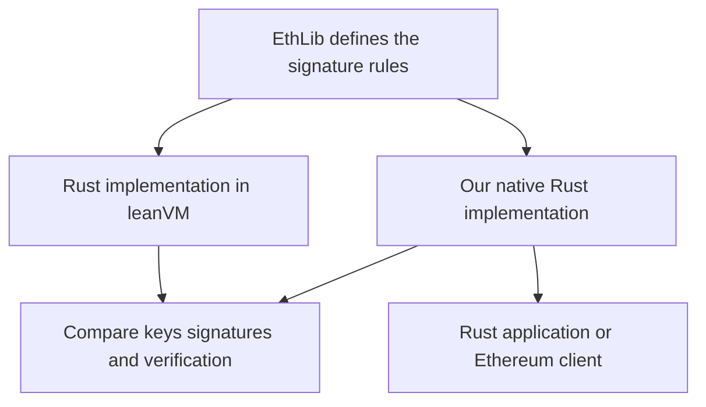
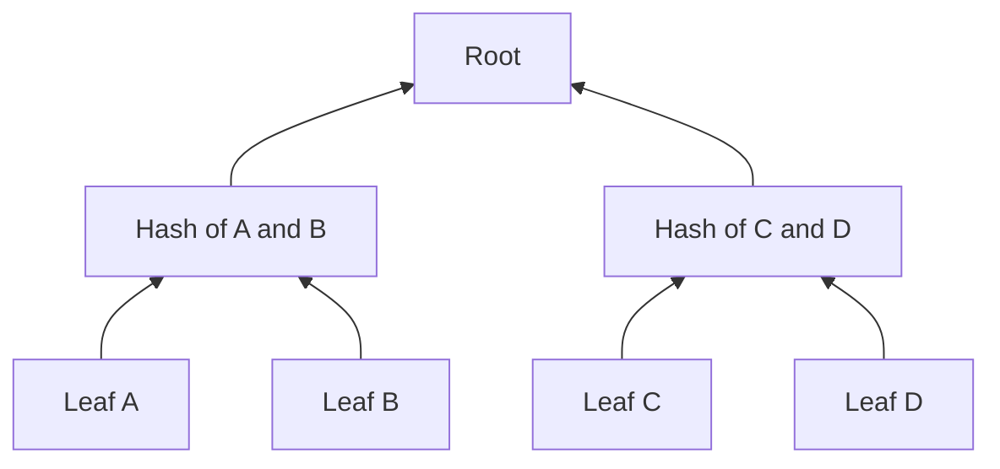

# Understanding leanSPHINCS and our Rust implementation

leanSPHINCS is an experimental way to prove who authorized a message using hash functions. Our `lean-sphincs` crate implements its key generation, signing and verification in Rust, using the configuration defined by EthLib.

The mathematics determines which signatures are valid. Our implementation concentrates on computing those rules efficiently and exposing a small API that Rust applications can use. It produces the same keys and signature bytes as the pinned specification; it does not introduce a different signature scheme.

Start with the first sections if public keys, hashes and Merkle trees are unfamiliar. The later sections explain the implementation, performance, tests and Ethereum integration.

# What a digital signature does

Imagine Alice wants to authorize a transaction. She creates a digital signature using a secret she controls. Bob can check the signature using Alice's public key, without learning the secret.

Three values have different jobs:

| Value | What it does | Who can see it |
| --- | --- | --- |
| Secret key | Creates signatures | Only the signer |
| Public key | Checks signatures | Anyone |
| Signature | Connects a particular message to the signing key | Anyone |

Changing the message should make the signature fail. A signature for “send 1 coin” must not authorize “send 100 coins.”

A signature authenticates data. It does not hide the data. Encryption solves a different problem.

Our API signs a **32-byte message digest**. A digest is a fixed-size fingerprint of a larger message. An Ethereum integration must first decide exactly which transaction fields to include, how to encode them and which signing domain to use. The crate receives the resulting digest.

A signing domain is context included in what gets signed. It helps prevent an authorization intended for one chain or operation from being reused for another. Our crate does not choose that context for the caller.

# Why Ethereum is exploring another signature scheme

Ethereum's familiar account signatures use ECDSA over the secp256k1 elliptic curve. Its security relies on a mathematical problem that sufficiently capable quantum computers could solve efficiently.

Hash-based signatures use a different foundation: the difficulty of finding particular inputs or collisions in cryptographic hash functions. Quantum algorithms still affect hash security, so the choice of hash sizes and parameters matters. “Post-quantum” means a design intended to withstand quantum attacks under its stated assumptions; it does not mean unconditional security.

SPHINCS+ is a family of stateless hash-based signatures. NIST standardized a scheme based on it as **SLH-DSA** in FIPS 205. leanSPHINCS adapts that general construction with Ethereum-oriented choices, including Keccak-256, WOTS+C and a particular tree configuration. Our crate implements that configuration, rather than the standardized FIPS 205 SHA2 or SHAKE parameter sets. [NIST FIPS 205](https://csrc.nist.gov/pubs/fips/205/final), [EthLib leanSPHINCS specification](https://github.com/ethereum/EthLib/blob/03547dd83f298a63e6dcceff0a0b75f6142490aa/EthLib/Cryptography/Sphincs/README.md).

# How the projects fit together

Several related projects appear in discussions because a new signature scheme needs a precise definition, working implementations and a plan for use by the network.

| Project or term | Its role |
| --- | --- |
| leanSPHINCS | The signature scheme and its chosen parameters |
| EthLib | Ethereum primitives written in Lean, with definitions and proofs |
| leanVM | A hash-based virtual machine for proving computation; its repository also contains a Rust leanSPHINCS implementation |
| Our lean-sphincs crate | A standalone native Rust implementation of the pinned leanSPHINCS configuration |
| Alloy | Rust types and utilities used by Ethereum software, including the byte types and hashing API we use |
| evm2 | An EVM implementation whose ECDSA recovery provider supplies our ecrecover benchmark |
| EIP-8288 | A draft proposal for integrating signature and proof aggregation into Ethereum |

Here, a **repository** is a source-code project managed with Git. A **crate** is a Rust package.

EthLib is broader than leanSPHINCS. It contains cryptographic primitives and Ethereum protocol definitions. Its leanSPHINCS module is the relevant part for this crate. [EthLib overview](https://github.com/ethereum/EthLib/tree/03547dd83f298a63e6dcceff0a0b75f6142490aa).

**Lean** is a programming language and proof assistant. It lets people express definitions and machine-check mathematical statements. **Lean Ethereum** is also the name used for a wider Ethereum research effort. A project with “lean” in its name does not necessarily run Lean code: our crate is Rust, and the Rust leanSPHINCS code in leanVM can be called directly as Rust code. [Lean Ethereum roadmap](https://leanroadmap.org/), [leanVM source](https://github.com/leanEthereum/leanVM/tree/f7ba4999ae523b94c8d0969b32762c3effea4cbd).

Names such as leanPCS and leanMempool describe other parts of the proposed work. PCS stands for polynomial commitment scheme: a component used to build proofs about computations. The mempool is the collection of pending transactions that nodes exchange before inclusion in a block. Those components are outside our signature crate. EIP-8288 concerns the larger aggregation design and remains a draft. Implementing the signature primitive does not activate that proposal on Ethereum. [EIP-8288](https://github.com/ethereum/EIPs/blob/master/EIPS/eip-8288.md).



# The building blocks

## Hash functions

A cryptographic hash function maps input bytes to a fixed-size output. Changing even one input bit should produce an unrelated-looking result. Computing the hash is easy; recovering an unknown input from its hash is intended to be difficult.

This configuration uses **Ethereum Keccak-256**. Tree values use the first 16 bytes of its output. Ethereum Keccak-256 and SHA3-256 have different padding and are not interchangeable.

The implementation labels hash inputs with their purpose and location. A hash used for one tree node must not accidentally be treated as a hash for a different node or signature component.

## Hash chains

Start with a secret value and repeatedly hash it:

```text
secret value -> first position -> second position -> final position
```

Someone who knows an intermediate value can continue hashing toward the end. They should not be able to move backward to earlier values.

A Winternitz one-time signature uses many such chains. A message determines which intermediate chain values the signer reveals. The verifier hashes those values forward to their public endpoints.

“One-time” describes an internal signing key, rather than the lifetime of the complete leanSPHINCS key. The larger construction arranges many internal keys into trees.

## Merkle trees

A Merkle tree combines many values into one root hash. Neighboring values are hashed together, and their parents are combined until one root remains.



To check that leaf A belongs under this root, the verifier needs B and the hash of C and D. These are its **authentication path**. The verifier reconstructs the root without receiving every leaf.

A tree of height 10 has 1,024 leaves but needs only 10 sibling values for one authentication path. This is how a small public key can authenticate a much larger collection of internal keys.

# How those pieces form leanSPHINCS

## FORS signs the message digest

FORS means **Forest of Random Subsets**. In this configuration, it uses 24 trees, each with 1,024 leaves.

A digest derived from the message selects a leaf in each tree. The signature reveals a secret value for each selected leaf and the authentication path needed to recover that tree's root. The verifier combines the 24 recovered roots into one FORS public key.

That FORS public key is then authenticated by the next part of the signature.

## WOTS C connects the layers

The scheme uses **WOTS+C**, a variant of a Winternitz one-time signature. Our configuration has 64 chains. Each chain has four positions, numbered 0 through 3.

An encoded message gives 64 digits, each between 0 and 3. The digits must add up to 128. The signer searches a four-byte counter until it finds an encoding with that sum, then includes the counter and the appropriate chain values in the signature.

The verifier checks the supplied counter once. It does not repeat the counter search. It finishes the remaining steps of the chains and combines their endpoints.

The fixed sum gives a useful work bound. The remaining chain steps total:

```text
64 chains × maximum position 3 − digit sum 128 = 64 steps
```

This rule is part of leanSPHINCS. Both implementations use it; it is not an optimization unique to our crate. [WOTS+C specification](https://github.com/ethereum/EthLib/blob/03547dd83f298a63e6dcceff0a0b75f6142490aa/EthLib/Cryptography/Sphincs/Ots.lean), [our WOTS+C implementation](https://github.com/Soubhik-10/lean-sphincs/blob/5af37e11ba0fb8f6bc54c6318568c7c34438fee5/src/wots.rs).

## The hypertree connects everything to the public key

A **hypertree** is a hierarchy of trees. Here it has three layers with heights 8, 8 and 10, counted from the bottom.

The bottom WOTS+C key signs the FORS public key. Its authentication path connects that key to the bottom tree's root. A middle WOTS+C key signs that root, and a top WOTS+C key signs the middle root.

After checking the top authentication path, the verifier reaches the root stored in the public key.

The chain of checks is:

```text
Message digest
  -> FORS openings
  -> FORS public key
  -> bottom WOTS+C signature and tree path
  -> middle WOTS+C signature and tree path
  -> top WOTS+C signature and tree path
  -> public key root
```

The final reconstructed root must equal the root supplied in the public key. Our verifier also checks the encoding rules and exact signature length. [Our verification code](https://github.com/Soubhik-10/lean-sphincs/blob/5af37e11ba0fb8f6bc54c6318568c7c34438fee5/src/verifier.rs).

# What the keys and signature contain

The **secret seed** is 32 bytes generated from a secure source of randomness. It must remain secret. The implementation derives the other secret material and public key from that seed.

The **public key** is 32 bytes:

```text
16 bytes of PK.seed || 16 bytes of PK.root
```

The double bar means “put these byte sequences next to each other.” PK.seed is public data used when hashing. Despite its name, it is not the secret signing seed. PK.root is the top tree's root.

The message passed to our API is exactly 32 bytes. A complete signature is exactly **7,740 bytes**, about 7.56 KiB.

| Signature component | Size |
| --- | ---: |
| Message randomizer | 16 bytes |
| FORS openings | 24 × 11 × 16 = 4,224 bytes |
| Three WOTS+C counters and chain values | 3 × (4 + 64 × 16) = 3,084 bytes |
| Authentication paths for the three layers | (8 + 8 + 10) × 16 = 416 bytes |
| Total | 7,740 bytes |

The randomizer helps derive which internal signing instance and leaves are used. Our signing is deterministic: the same secret seed and message produce the same randomizer and signature.

Byte order matters. The current layout follows FIPS 205 address encoding and big-endian integer fields. Older implementations using a different public-key order or address layout can disagree even when both are called leanSPHINCS. Compatibility requires the same configuration and encoding, rather than just the same name. [Pinned serialization rules](https://github.com/ethereum/EthLib/blob/03547dd83f298a63e6dcceff0a0b75f6142490aa/EthLib/Cryptography/Sphincs/Serialization.lean).

# What stateless means

Some hash-based signature schemes require a signer to remember exactly which internal signing key was used last. Accidentally reusing one after restoring an old backup can be dangerous.

leanSPHINCS does not require that persistent next-leaf counter. Its message-dependent selection and FORS construction support many signatures from one master seed.

There is still a lifetime limit: **one key must sign at most 2 to the power of 30 messages**, approximately 1.07 billion. That limit belongs to the chosen security parameters. Our crate does not count signatures or enforce retirement of a key.

A stateless signing algorithm therefore still needs application-level key management. An application must generate seeds securely, protect them, choose the correct message domain and manage the key's permitted usage. [EthLib key usage rules](https://github.com/ethereum/EthLib/blob/03547dd83f298a63e6dcceff0a0b75f6142490aa/EthLib/Cryptography/Sphincs/README.md).

# What our crate actually provides

The public API has three main operations:

| Function | Input | Result |
| --- | --- | --- |
| `key_gen` | A 32-byte secret seed | A 32-byte public key |
| `sign` | The secret seed and a 32-byte message digest | A 7,740-byte signature or an error |
| `verify` | Public key, message digest and signature bytes | `true` or `false` |

**Key generation** computes the top tree's public root. **Signing** derives the required secret values, searches the WOTS+C counters and builds the tree paths. **Verification** uses the values already supplied in the signature to reconstruct roots. It does not rebuild all of the trees. This explains why signing and key generation take milliseconds while verification can take microseconds.

The library is `no_std`, meaning its core API does not require Rust's standard library or an operating system. All three operations avoid heap allocation. Signing does use roughly 32 KiB of stack memory for a public tree cache, in addition to its signature and other working data.

The crate forbids unsafe Rust in its own source. Dependencies can have their own implementation requirements, including assembly backends.

It is a native implementation: callers execute Rust code directly. They do not need to start leanVM, generate a proof, call Python or run Lean to verify one signature.

It supplies the cryptographic primitive. Transaction encoding, networking, proof aggregation and Ethereum fork activation belong to integration code. [Public API](https://github.com/Soubhik-10/lean-sphincs/blob/5af37e11ba0fb8f6bc54c6318568c7c34438fee5/src/lib.rs), [signing implementation](https://github.com/Soubhik-10/lean-sphincs/blob/5af37e11ba0fb8f6bc54c6318568c7c34438fee5/src/signing.rs).

# Why we use Alloy types

Alloy provides common types used throughout Rust Ethereum software.

`B256` holds exactly 32 bytes. We use it for the secret seed, public key and message digest. This makes incorrect byte lengths harder to pass into the API. It does not prevent mixing up their meanings: all three have the same Rust type, so the caller still needs to pass them in the right places.

The signature type holds exactly 7,740 bytes. Verification also accepts a borrowed byte slice, so it can check received signature bytes without first allocating a separate object.

Alloy's `Address` is an Ethereum account address: 20 bytes. Our private `HashContext` has a different job. It holds the public seed, a 32-byte cryptographic address describing a tree location, and working space for hash inputs.

That cryptographic address labels the layer, tree, operation and node or chain position. Calling the buffer `HashContext` distinguishes it from an Ethereum account address. It is private implementation machinery, rather than another public key type. [HashContext implementation](https://github.com/Soubhik-10/lean-sphincs/blob/5af37e11ba0fb8f6bc54c6318568c7c34438fee5/src/hash.rs).

# How the source code is organized

| File | Responsibility |
| --- | --- |
| `lib.rs` | Public API, exported types and length checks |
| `params.rs` | Fixed scheme parameters |
| `signature.rs` | Reading fields directly from signature bytes |
| `hash.rs` | Hash input layout, domain labels and message digest |
| `hash/pair.rs` | Paired SIMD Keccak for the supported baseline x86-64 path |
| `fors.rs` | FORS signing and recovery |
| `wots.rs` | WOTS+C encoding, counters, chains and recovery |
| `tree.rs` | Tree construction and authentication paths |
| `signing.rs` | Key generation and complete signing |
| `verifier.rs` | Connecting all verification stages |

A useful reading order is `lib.rs`, then `verifier.rs`, then the component files it calls. Start with the public inputs and final root comparison before studying the hash internals.

The production crate depends on Alloy primitives and, on x86-64, the safe SIMD types from `wide`. The leanVM comparison library and evm2 are used by separate development harnesses; they are not production dependencies of the signature crate. [Crate manifest](https://github.com/Soubhik-10/lean-sphincs/blob/5af37e11ba0fb8f6bc54c6318568c7c34438fee5/Cargo.toml).

# How our implementation reduces overhead

The signature format and valid outputs stay the same. The implementation changes how data moves through the computation and how independent work is scheduled.

## Read the signature where it already is

A received signature is a sequence of bytes. Our reader borrows fixed-size fields from that sequence rather than first building a large owned signature object.

This avoids an additional full-signature representation and allocation. The verifier still reads the required bytes and performs the required cryptographic work. [Signature reader](https://github.com/Soubhik-10/lean-sphincs/blob/5af37e11ba0fb8f6bc54c6318568c7c34438fee5/src/signature.rs).

## Stream intermediate values into hashers

FORS produces 24 roots. WOTS+C produces 64 chain endpoints. Our code feeds each value into an incremental hasher as it becomes available.

This avoids collecting an entire temporary array and then reading it again just to hash it. The order of values remains the order required by the scheme. [FORS code](https://github.com/Soubhik-10/lean-sphincs/blob/5af37e11ba0fb8f6bc54c6318568c7c34438fee5/src/fors.rs), [WOTS+C code](https://github.com/Soubhik-10/lean-sphincs/blob/5af37e11ba0fb8f6bc54c6318568c7c34438fee5/src/wots.rs).

## Reuse a hash input buffer

Many small hashes share the same public seed and location fields. `HashContext` keeps those bytes in place and updates the part that changes.

Reusing the buffer reduces repeated setup and copying. It does not reuse a previous hash result in place of a required computation.

## Process independent FORS paths together

Two different FORS trees can be checked independently. On x86-64 builds with SSE2 enabled and AVX2 disabled, our code processes two paths together with SIMD operations.

SIMD means one instruction can operate on several data lanes. The two paths still compute their own hashes; the CPU carries out parts of both computations together. This is instruction-level parallelism within a thread, rather than spawning a second operating-system thread.

AVX2-enabled builds use the selected Alloy hashing backend instead of this paired path. [Paired FORS implementation](https://github.com/Soubhik-10/lean-sphincs/blob/5af37e11ba0fb8f6bc54c6318568c7c34438fee5/src/fors.rs).

## Build signing trees once

Signing needs both a tree root and an authentication path. Our tree builder collects what it needs during one construction. For the top tree, a stack cache retains public nodes so both uses share the same work.

The cache lasts for that signing call and is built within the measured signing operation. [Tree implementation](https://github.com/Soubhik-10/lean-sphincs/blob/5af37e11ba0fb8f6bc54c6318568c7c34438fee5/src/tree.rs).

These mechanisms explain the implementation strategy. The benchmark measures their combined result. Separate measurements with individual optimizations disabled would be needed to assign an exact percentage of the speedup to each one.

# Why the hash backend and compiler matter

The scheme performs many hashes. The cost of the underlying Keccak implementation therefore strongly affects its running time.

Our benchmark uses three hashing choices:

| Backend | Meaning |
| --- | --- |
| RustCrypto | The default hashing path selected through Alloy |
| tiny-keccak | Another Rust Keccak implementation selected through Alloy in the benchmark |
| asm-keccak | The assembly-backed hashing path enabled by the crate's optional feature |

The production crate directly exposes `asm-keccak`; the isolated benchmark manifest also exposes the tiny-keccak comparison configuration.

These labels describe our crate's Alloy hashing choice. Our SSE2 and SSE4.2 verification builds also use the paired FORS path described above. leanVM has its own hashing code: on this x86-64 machine its single-state path is scalar or AVX-512, while its batch path selects scalar, four-way AVX2 or eight-way AVX-512 according to the compiler target. Changing our Alloy backend does not switch leanVM to that backend.

SSE2, SSE4.2, AVX2 and AVX-512 name CPU instruction capabilities. They describe what the compiler may use. “Native” tells the compiler to tune for the machine doing the build. These are compilation settings, rather than different signature formats.

Newer instructions do not automatically produce faster code. Compiler decisions, data shuffling and the workload all matter. The benchmark builder disables LLVM SLP vectorization for affected tiny-keccak AVX2, AVX-512 and native builds. This setting applies to both implementations in the binary and keeps their explicit SIMD code enabled. The current published rows include this compiler fix.

The latest confirmation also selects this compiler setting for RustCrypto and assembly builds. All signature candidates use the native CPU target with automatic SLP vectorization disabled. leanVM's explicit AVX-512 code remains enabled.

Enabling assembly also does not change the signature scheme or reduce its required permutations. It changes how the CPU executes the hashing. [Benchmark configurations and results](../README.md#native-benchmark-results).

# What the performance numbers actually show

The published signature measurements use an AMD Ryzen 9 8940HX with Rust 1.97.1 and LLVM 22.1.6. A sweep of 25 configurations selects two candidate builds. Those builds are then measured separately, using 44 batch samples per pass over three passes and 11 shared key/message pairs. The headline table uses the lowest complete confirmation median for each operation and implementation. All configurations and samples remain available.

There are now three implementations in the comparison. Our crate uses assembly hashing for its best confirmed results. The unmodified leanVM implementation uses its own AVX-512 single-state hasher. A separate local experimental adapter uses leanVM's public internals and eight-way SIMD hashing, with local scheduling and wire handling. That adapter is benchmark code; its results are not attributed to an upstream leanVM release.

| Operation | Our crate | leanVM (unmodified, pinned revision) | leanVM + local SIMD batching adapter |
| --- | ---: | ---: | ---: |
| Verification | 88.33 microseconds | 119.12 microseconds | 38.71 microseconds |
| Signing | 89.02 milliseconds | 119.05 milliseconds | 22.72 milliseconds |
| Key generation | 46.69 milliseconds | 61.68 milliseconds | 12.08 milliseconds |

A microsecond is one millionth of a second. A millisecond is one thousandth. For scale, 88.33 microseconds is 0.08833 milliseconds, so these signing and verification numbers differ by roughly three orders of magnitude.

The local adapter has about 2.28 times our verification speed: 88.33 divided by 38.71 is about 2.28. That is about a 128 percent speed increase, or about a 56 percent reduction in elapsed time. These are different ways to describe the same comparison. Published percentages are calculated from the unrounded measurements.

The adapter processes independent hashes from one operation together on a single thread. It does not get its result by dividing the time for several signatures by their count. Both implementations recompute keys and signatures from the seed during timing, with no persistent tree cache. All verification starts from encoded signatures, and signing includes producing the encoded result. The timing excludes VM execution proofs, aggregation and network communication.

Our crate beats the unmodified dependency in this comparison; the local SIMD adapter beats both. Its speedup combines its scheduling and data-flow choices. These results do not establish a universal winner or the maximum possible performance of either codebase. Small differences between builds using the same reference hashing code should not be interpreted as proof of a backend advantage.

The sample size and single-machine setup also limit how widely the results can be generalized. [Complete published benchmark tables](../README.md#native-benchmark-results), [raw measurements and method](../benchmarks/SUITE.md#published-measurements).

# Why verification uses 515 permutations

Keccak-256 processes data using an internal operation called **Keccak-f 1600**. This permutation mixes a 1,600-bit internal state through 24 rounds.

A hash call and a permutation are different units of work. Keccak-256 absorbs 136 input bytes at a time. A short input needs one permutation; a longer input can need several.

For this leanSPHINCS configuration, a valid verification uses:

| Work | Permutations |
| --- | ---: |
| Derive the message digest | 2 |
| Recover 24 FORS paths with 11 hashes each | 264 |
| Combine the FORS roots | 4 |
| Three WOTS+C encodings, chain recoveries and endpoint hashes | 219 |
| Climb the hypertree paths of heights 8, 8 and 10 | 26 |
| Total | 515 |

The WOTS+C subtotal is three times 73: one encoding hash, 64 remaining chain steps and eight permutations to combine the endpoints.

The same work can be described as **491 complete hash calls**. Some calls consume multiple permutations, which brings the permutation total to 515. This is why counts with different units should not be compared as if they meant the same thing.

Our valid verifier and the matching reference both perform the scheme's required work. Parallel hashing can reduce elapsed time without reducing the number of permutations. Malformed signatures can be rejected earlier and therefore use less work. [EthLib verification accounting](https://github.com/ethereum/EthLib/blob/03547dd83f298a63e6dcceff0a0b75f6142490aa/EthLib/Cryptography/Sphincs/README.md), [our verifier](https://github.com/Soubhik-10/lean-sphincs/blob/5af37e11ba0fb8f6bc54c6318568c7c34438fee5/src/verifier.rs).

# What ecrecover and gas comparisons mean

**ecrecover** is an Ethereum operation that recovers a signing account address from an ECDSA signature and message digest. leanSPHINCS verification checks a supplied public key; it does not recover an Ethereum account address in the same way.

Our benchmark calls evm2's recovery provider directly. It includes ECDSA signature parsing, public-key recovery, serialization and address hashing. It excludes EVM transaction dispatch and calldata costs.

A timing ratio answers a limited question: how much CPU time did these two operations take in the same measurement conditions?

For example, a claim that verification is **8.4 times ecrecover** means:

```text
leanSPHINCS verification time / ecrecover time = 8.4
```

If ecrecover took 10 microseconds and verification took 84 microseconds, the ratio would be 8.4. These two values are an illustration, not our measured results.

A simple CPU-ratio gas estimate multiplies that ratio by a chosen ecrecover gas baseline. Using a baseline of 3,000 gives 25,200. A proposed price of 12,600 would correspond to a ratio of 4.2 under that calculation.

This arithmetic can help discuss a proposal. It does not determine Ethereum gas pricing. A gas schedule must account for workload limits, different implementations and machines, and costs such as carrying large signatures. This crate has no built-in gas schedule. [Our benchmark method](https://github.com/Soubhik-10/lean-sphincs/blob/5af37e11ba0fb8f6bc54c6318568c7c34438fee5/benchmarks/evm2/README.md).

# What testing can establish

A **known-answer test** supplies a fixed input and a previously specified output. Our committed tests include 35 pinned EthLib cases covering key generation, signing and verification, including malformed inputs.

They also check deterministic signature bytes, changes to every signature byte, wrong keys and messages, every truncated signature length, trailing bytes and heap allocation behavior. [Committed tests](https://github.com/Soubhik-10/lean-sphincs/tree/5af37e11ba0fb8f6bc54c6318568c7c34438fee5/tests), [test data provenance](https://github.com/Soubhik-10/lean-sphincs/blob/5af37e11ba0fb8f6bc54c6318568c7c34438fee5/tests/vectors/README.md).

A **differential test** gives identical inputs to two implementations and compares their results. Comparing complete keys and all 7,740 signature bytes catches disagreements that a simple successful round trip might miss.

The local development harness completed 10,000 generated key and message pairs with no mismatch: 10,000 key comparisons, 10,314 signature comparisons including repeated signing, and 560,000 verification checks. Additional native RustCrypto, assembly and tiny-keccak campaigns completed 512 cases each. The same first 512 inputs were reused across those backends, so they are additional configurations rather than 1,536 additional unique input pairs.

**Coverage-guided fuzzing** repeatedly changes inputs and favors changes that exercise new code paths. Local sanitizer runs completed 378,045 raw-verification executions and 143,278 structured-mutation executions without a reported mismatch or sanitizer error. Signing fuzzing is much slower; a further run completed 20 executions. These are execution counts, not counts of distinct valid signatures.

The randomized and fuzzing harnesses live in `testing` and `fuzz`. Raw run artifacts remain local.

Tests provide evidence of compatibility and robustness for the inputs exercised. They do not establish that two implementations lack a shared bug, that the scheme's assumptions are correct, or that signing is protected against every timing or memory-disclosure attack. This crate has no independent audit or formal proof of its Rust implementation.

# What EthLib proofs mean for our Rust code

A formal proof can establish that a mathematical statement follows from particular definitions and assumptions. EthLib contains proofs about its Lean definitions, including how honest signatures verify and how the signature construction behaves under specified models.

Those proofs do not automatically prove that a separate Rust implementation matches the definitions. That connection needs its own argument or verification.

Our pinned tests and differential comparisons help check that connection experimentally. They do not transfer EthLib's proof status to our Rust source, compiled binaries or dependencies.

The scope matters for EthLib itself as well. Its soundness document distinguishes the definitions, compiler, runtime, bindings and timing behavior. A correctness theorem about signatures and a claim that an application safely protects signing secrets are different claims. [EthLib soundness document](https://github.com/ethereum/EthLib/blob/03547dd83f298a63e6dcceff0a0b75f6142490aa/SOUNDNESS.md).

# Using the crate in an application

A minimal round trip looks like this:

```rust
use lean_sphincs::{B256, SignError, key_gen, sign, verify};

fn round_trip(
    secret_seed: &B256,
    message_digest: &B256,
) -> Result<bool, SignError> {
    let public_key = key_gen(secret_seed);
    let signature = sign(secret_seed, message_digest)?;

    Ok(verify(
        &public_key,
        message_digest,
        signature.as_slice(),
    ))
}
```

This example assumes the caller already has a securely generated secret seed and the correct message digest. It does not demonstrate a wallet's randomness generation, secret storage or transaction encoding.

For an Ethereum client, integrating the crate means calling verification from the appropriate transaction or precompile logic. The client must still define malformed-input behavior, activation rules, gas accounting and protocol tests.

Because the API uses ordinary Rust and Alloy byte types, it can be integrated without importing the full leanVM project into the production dependency graph. The comparison implementation belongs in the development harness when testing compatibility.

# Glossary

| Term | Simple meaning |
| --- | --- |
| Authentication path | Sibling hashes needed to reconstruct a Merkle root from a leaf |
| Backend | The implementation used for a particular operation, such as Keccak hashing |
| Crate | A Rust package |
| Digest | A fixed-size fingerprint of input data |
| Domain separation | Labels or context that keep cryptographic uses distinct |
| FORS | The collection of small trees used to sign a message digest |
| Hash chain | Repeated hashing that is easy to follow forward and hard to reverse |
| Heap allocation | Requesting dynamic memory from an allocator |
| Hypertree | A hierarchy of trees connecting internal signing keys to one public root |
| Known-answer test | A fixed input checked against a specified output |
| Native implementation | Code executed directly in the application's normal runtime |
| Permutation | Keccak's internal state-mixing operation |
| Public seed | Public hash input used by this scheme; separate from the secret signing seed |
| Reference implementation | A particular implementation used for comparison |
| SIMD | Instructions that perform similar work across several data lanes |
| Stack | Memory used for function calls and their temporary local data |
| Stateless signature | A signature algorithm without a persistent next-leaf counter |
| WOTS+C | The internal chain-based signature with a constrained message encoding |
| zkVM | A virtual machine designed to support proofs about program execution |

# Source revisions and further reading

The implementation explanations and published timing examples refer to the pushed crate revision `5af37e11ba0fb8f6bc54c6318568c7c34438fee5`. The local test campaign results are identified separately above.

- [Our crate and README](https://github.com/Soubhik-10/lean-sphincs/tree/5af37e11ba0fb8f6bc54c6318568c7c34438fee5)
- [EthLib leanSPHINCS specification at the pinned revision](https://github.com/ethereum/EthLib/tree/03547dd83f298a63e6dcceff0a0b75f6142490aa/EthLib/Cryptography/Sphincs)
- [EthLib soundness and proof scope](https://github.com/ethereum/EthLib/blob/03547dd83f298a63e6dcceff0a0b75f6142490aa/SOUNDNESS.md)
- [Rust comparison implementation in leanVM at the pinned revision](https://github.com/leanEthereum/leanVM/tree/f7ba4999ae523b94c8d0969b32762c3effea4cbd/crates/lean_sphincs)
- [NIST FIPS 205 background on SLH-DSA](https://csrc.nist.gov/pubs/fips/205/final)
- [EIP-8288 draft integration proposal](https://github.com/ethereum/EIPs/blob/master/EIPS/eip-8288.md)
